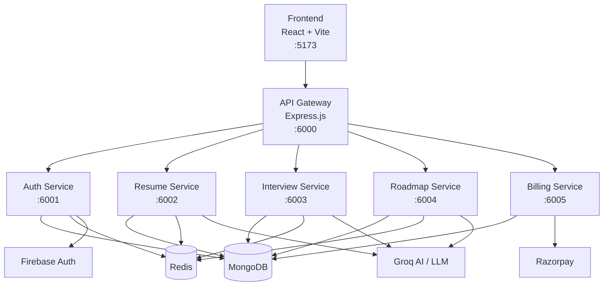
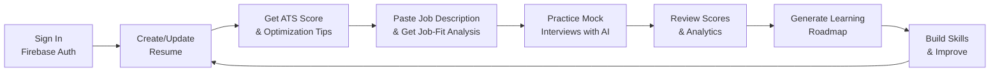
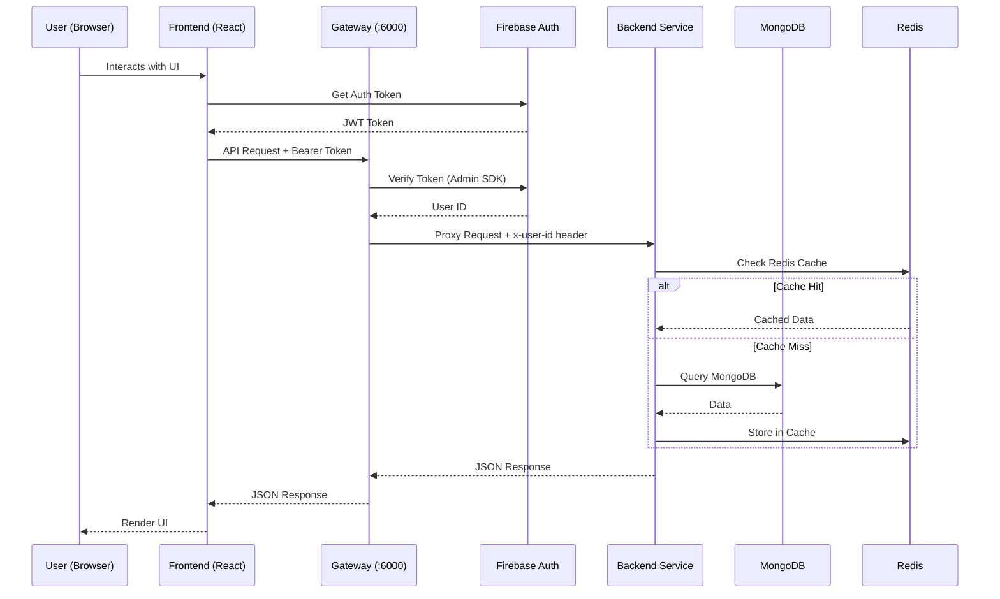
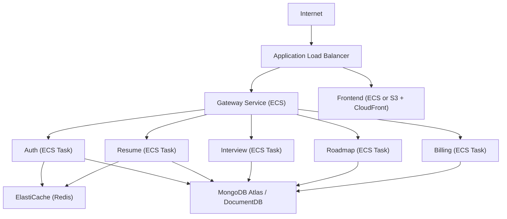

# FresherAI — Complete Application Overview

## 🎯 What Is FresherAI?

**FresherAI** is an **AI-powered career growth platform** specifically built for **freshers and early-career professionals**. It's a one-stop solution that combines:

- AI resume building & ATS optimization
- AI-driven mock interview simulation
- Personalized learning roadmap generation
- Career analytics & progress tracking
- Subscription-based monetization

The core problem it solves: **Most job seekers don't know how to write an ATS-friendly resume, practice interviews without feedback, or plan what skills to learn next.** FresherAI tackles all three.

---

## 🏗️ Architecture at a Glance

FresherAI uses a **microservice-based architecture** with a React frontend and multiple independent Node.js backend services, all routed through an API Gateway.



---

## 🧱 Tech Stack

| Layer | Technologies |
|-------|-------------|
| **Frontend** | React, Vite, JavaScript/JSX, Redux Toolkit, React Router, Axios, Motion UI animations, Recharts |
| **Backend** | Node.js, Express.js, Mongoose (MongoDB ODM) |
| **Database** | MongoDB (document store per service) |
| **Caching** | Redis (shared across services) |
| **Authentication** | Firebase Auth (client) + Firebase Admin SDK (server) |
| **AI / LLM** | Groq LLM (via OpenAI-compatible SDK) — powers resume analysis, interview Q&A, roadmap generation, and job-fit matching |
| **Payments** | Razorpay SDK |
| **DevOps** | Docker, Docker Compose, Dockerfiles per service |

---

## 📂 Project Structure

```
fresherAI/
├── backend/
│   ├── gateway1/               ← API Gateway (central request router)
│   │   ├── controllers/
│   │   ├── middlewares/        ← Auth middleware (Firebase token verification)
│   │   ├── utils/
│   │   ├── index.js
│   │   └── Dockerfile
│   ├── services/
│   │   ├── auth-service1/      ← User authentication & session management
│   │   ├── resume-service1/    ← Resume builder, ATS scoring, Job-Fit analysis
│   │   │   ├── agents/         ← AI agents (resumeAgent, jobFitAgent)
│   │   │   ├── configs/        ← LLM configuration (Groq)
│   │   │   ├── controllers/
│   │   │   ├── model/          ← Mongoose models (Resume, JobFitAnalysis)
│   │   │   ├── routes/
│   │   │   └── uploads/        ← Uploaded resume PDFs
│   │   ├── interview-service1/ ← AI mock interviews
│   │   │   ├── agents/         ← Interview AI agents
│   │   │   ├── graph/          ← Interview flow/state graph
│   │   │   ├── prompts/        ← Interview prompt templates
│   │   │   ├── controllers/
│   │   │   ├── model/
│   │   │   └── routes/
│   │   ├── roadmap-service1/   ← Personalized learning roadmap generator
│   │   ├── billing-service1/   ← Razorpay billing & coin management
│   │   └── uploads/
│   ├── shared/                 ← Shared utilities (Redis client, common helpers)
│   ├── docker-compose.yml      ← Redis container setup
│   └── package.json
├── frontend/
│   ├── src/
│   │   ├── api/                ← API layer (Axios calls)
│   │   │   ├── interview.api.js
│   │   │   ├── resume.api.js
│   │   │   └── user.api.js
│   │   ├── components/
│   │   │   ├── Sidebar.jsx
│   │   │   ├── LoginModel.jsx
│   │   │   ├── Statbox.jsx
│   │   │   ├── InterviewGraph.jsx
│   │   │   ├── PricingCard.jsx
│   │   │   ├── interview/      ← Interview UI components
│   │   │   ├── resume/         ← Resume builder UI components
│   │   │   └── roadmap/        ← Roadmap UI components
│   │   ├── pages/
│   │   │   ├── Home.jsx        ← Landing page
│   │   │   ├── Dashbord.jsx    ← User dashboard
│   │   │   ├── Scorer.jsx      ← ATS resume scorer
│   │   │   ├── JobFit.jsx      ← Resume ↔ JD matching
│   │   │   ├── ResumeBuilder.jsx
│   │   │   ├── InterviewPage.jsx
│   │   │   ├── InterviewStart.jsx
│   │   │   ├── InterviewReport.jsx
│   │   │   ├── Roadmap.jsx
│   │   │   └── Pricing.jsx
│   │   ├── redux/              ← Redux Toolkit state management
│   │   ├── utils/
│   │   ├── App.jsx
│   │   └── main.jsx
│   ├── public/
│   ├── vite.config.js
│   └── package.json
├── PRD-ATS-JobFit-Analysis.md  ← Product Requirement Doc for Job-Fit feature
├── future-planning.md          ← Future roadmap + AWS deployment guide
├── professional.md             ← Local setup guide
├── deployment.txt
├── APPLICATION_OVERVIEW.md     ← This file
└── README.md
```

---

## ⚙️ Feature-by-Feature Deep Dive

### 1. 🔐 Authentication (Auth Service — `:6001`)

- **Firebase-based authentication** for user sign-in/sign-up
- Gateway middleware (`isAuth`) verifies Firebase tokens on every protected request
- Injects `x-user-id` header into proxied requests so downstream services know which user is making the call
- Session-based access control with logout support

### 2. 📝 AI Resume Builder (Resume Service — `:6002`)

- **Step-by-step resume creation** with structured sections:
  - Personal details & profile summary
  - Skills
  - Work experience
  - Projects
  - Education
- **ATS Resume Scorer**: Upload a PDF resume → AI analyzes it and returns:
  - Overall ATS score (0–100)
  - Strengths & weaknesses
  - Missing skills
  - Suggested improvements
- Uses **Groq LLM** (via `resumeAgent`) to extract and analyze resume content
- Resume data stored in MongoDB; cached in Redis for fast retrieval

### 3. 🎯 ATS Job-Fit Analysis (Resume Service — New Feature)

> **Note:** This is a recently designed feature (PRD dated 2026-08-26) that compares a user's resume against a specific job description.

- User pastes a **Job Description (JD)** + optional job title
- AI agent (`jobFitAgent`) compares resume text ↔ JD and returns:
  - **Match Score** (0–100)
  - **Matched Skills** — skills in both resume and JD
  - **Missing Skills** — skills the JD requires but resume lacks
  - **Matched/Missing Keywords** — ATS keyword gap analysis
  - **Role Strengths** — resume strengths relevant to this specific role
  - **Recommendations** — concrete, actionable resume improvements
- Results cached in Redis (24h TTL, keyed by user + JD hash)
- Full analysis history saved to MongoDB (view past analyses anytime)
- Gated by **coin system** (costs coins per analysis)

### 4. 🎙️ AI Interview Preparation (Interview Service — `:6003`)

- **Multi-stage mock interview simulation**:
  - Technical interviews (coding + system design)
  - HR/behavioral interviews
  - Adaptive AI follow-up questions
- Uses an **interview flow graph** (`graph/` directory) to manage interview state transitions
- **Prompt engineering** (`prompts/` directory) with specialized templates for different interview types
- AI agents generate contextual questions based on user's resume and target role
- **Interactive coding/editor experience** during technical rounds
- After each session:
  - Automated scoring and evaluation
  - Detailed performance report
  - Answer quality assessment

### 5. 📊 Career Dashboard

The dashboard provides a centralized performance overview:

| Metric | Description |
|--------|-------------|
| Total Interviews | Number of mock interview sessions created |
| Total Questions | Questions answered across all sessions |
| Completion Rate | % of interviews completed vs started |
| Average Score | Mean score across all evaluated sessions |
| Performance Charts | Historical trends via `InterviewGraph.jsx` (Recharts) |

Quick navigation tiles link to Resume Builder, Interview, Roadmap, and Billing modules.

### 6. 🗺️ Personalized AI Roadmap Generator (Roadmap Service — `:6004`)

- User inputs:
  - **Target role** (e.g., Frontend Developer, ML Engineer, Backend Engineer)
  - **Target salary/package**
  - Optionally uses resume context for personalization
- AI generates a **structured learning path** including:
  - Skills to learn (in order)
  - Recommended projects
  - Study resources
  - Milestones and timelines
- Roadmap history saved for future reference
- Users can compare and revisit previous roadmaps

### 7. 💳 Billing & Subscription (Billing Service — `:6005`)

- **Razorpay-powered** payment integration
- **Coin-based economy** for AI features:
  - Resume scoring, Job-Fit analysis, interviews, roadmaps consume coins
  - Insufficient coins → action blocked with clear messaging
- Premium subscription plans for unlimited/enhanced access
- Transaction tracking and billing history

### 8. 🌐 API Gateway (`:6000`)

The gateway is the **single entry point** for all frontend requests:

- Proxies requests to the appropriate backend service based on path:
  - `/api/auth/*` → Auth Service
  - `/api/resume/*` → Resume Service
  - `/api/interview/*` → Interview Service
  - `/api/roadmap/*` → Roadmap Service
  - `/api/billing/*` → Billing Service
- Applies `isAuth` middleware (Firebase token verification) on protected routes
- Injects `x-user-id` via `proxyWithUser` utility
- CORS configuration for frontend origin

---

## 🔄 Core User Workflow



---

## 🔧 Service Communication Pattern



---

## 🔌 API Endpoints Overview

### Auth Service (`/api/auth`)

| Method | Endpoint | Description |
|--------|----------|-------------|
| POST | `/api/auth/login` | User login via Firebase token |
| POST | `/api/auth/register` | User registration |
| GET | `/api/auth/me` | Get current user profile |
| POST | `/api/auth/use-coins` | Deduct coins for AI features |

### Resume Service (`/api/resume`)

| Method | Endpoint | Description |
|--------|----------|-------------|
| POST | `/api/resume/upload` | Upload resume PDF for ATS analysis |
| GET | `/api/resume` | Get user's resume data |
| PUT | `/api/resume` | Update resume sections |
| POST | `/api/resume/job-fit` | Analyze resume vs job description |
| GET | `/api/resume/job-fit` | Get all job-fit analysis history |
| GET | `/api/resume/job-fit/:id` | Get specific job-fit analysis |

### Interview Service (`/api/interview`)

| Method | Endpoint | Description |
|--------|----------|-------------|
| POST | `/api/interview/create` | Create a new interview session |
| GET | `/api/interview` | List user's interview sessions |
| GET | `/api/interview/:id` | Get interview session details |
| POST | `/api/interview/:id/answer` | Submit answer to interview question |
| POST | `/api/interview/:id/next` | Move to next interview question |
| GET | `/api/interview/:id/report` | Get interview performance report |

### Roadmap Service (`/api/roadmap`)

| Method | Endpoint | Description |
|--------|----------|-------------|
| POST | `/api/roadmap/generate` | Generate a personalized roadmap |
| GET | `/api/roadmap` | List user's roadmaps |
| GET | `/api/roadmap/:id` | Get specific roadmap details |

### Billing Service (`/api/billing`)

| Method | Endpoint | Description |
|--------|----------|-------------|
| POST | `/api/billing/create-order` | Create Razorpay order |
| POST | `/api/billing/verify` | Verify payment |
| GET | `/api/billing/plans` | Get subscription plans |

---

## 🚀 Deployment

### Local Development

- **7 processes** run simultaneously: Redis (Docker), Gateway, 5 backend services, and Frontend
- Each service has its own `.env` for port, database URL, API keys, etc.

#### Default Service Ports

| Service | Port |
|---------|------|
| Frontend | `http://localhost:5173` |
| Gateway | `http://localhost:6000` |
| Auth | `http://localhost:6001` |
| Resume | `http://localhost:6002` |
| Interview | `http://localhost:6003` |
| Roadmap | `http://localhost:6004` |
| Billing | `http://localhost:6005` |

### Production (AWS — Planned)

The project is designed for **containerized AWS deployment**:

| AWS Service | Purpose |
|-------------|---------|
| **ECR** | Docker image registry |
| **ECS (Fargate)** | Container orchestration for all services |
| **ALB** | Load balancer with path-based routing |
| **VPC + Subnets** | Network isolation |
| **ElastiCache** | Managed Redis |
| **MongoDB Atlas / DocumentDB** | Managed database |
| **CloudWatch** | Monitoring & logging |
| **Route 53 + ACM** | DNS + SSL |



---

## 🔮 Future Roadmap

The planned evolution from a **tool** into a **career operating system**:

| Phase | Features |
|-------|----------|
| **Phase 1** — Core Improvements | Better resume optimization engine, deeper interview analytics, improved roadmap personalization, dashboard UX refresh |
| **Phase 2** — Growth Features | Gamification (XP, streaks, badges), job matching & recommendations, mentor marketplace, premium plan enhancements |
| **Phase 3** — Platform Scale | Mobile app (Android + iOS), enterprise/campus hiring integration, voice & video AI interviews, community & social features, admin dashboard |

### Planned Features Include:

- **AI Career Coach** — weekly personalized recommendations
- **Skill Assessment Hub** — MCQ tests, coding challenges, leaderboards
- **Job Opportunity Integration** — job listings, application tracking, AI cover letter generation
- **Multi-Modal AI** — voice interviews, video simulation, speech analysis
- **LinkedIn/GitHub sync** and coding platform integrations
- **Mentor Marketplace** — book sessions with industry experts

---

## 📊 Summary

| Aspect | Detail |
|--------|--------|
| **Target Users** | Freshers, college students, early-career professionals |
| **Core Value** | AI-powered resume optimization + interview prep + career planning in one platform |
| **Architecture** | Microservices (6 backend services + API Gateway) |
| **Frontend** | React + Vite + Redux Toolkit |
| **Backend** | Node.js + Express per service |
| **Database** | MongoDB (per-service) + Redis (shared cache) |
| **AI Engine** | Groq LLM (OpenAI-compatible) for all AI features |
| **Auth** | Firebase Authentication |
| **Payments** | Razorpay + coin-based economy |
| **Deployment** | Docker (local) → AWS ECS/ECR (production) |
| **Total Pages** | 10 (Home, Dashboard, Scorer, JobFit, ResumeBuilder, InterviewPage, InterviewStart, InterviewReport, Roadmap, Pricing) |
| **Total Services** | 6 (Gateway, Auth, Resume, Interview, Roadmap, Billing) |
